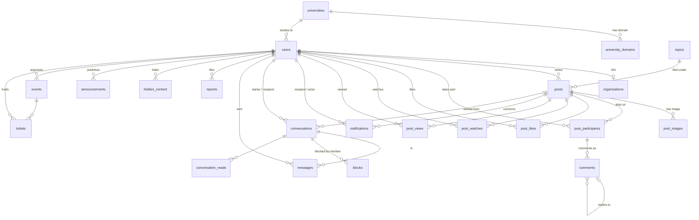

# Data model

**Version 1.0, 17 Oct 2026.** The schema itself is `db/schema.sql` in the repository, and the seed is `db/seed/core.sql`. This file explains it: the E-R model in the course's notation, who writes which table, the seed data you test against, and the database features the presentation can show. Everything here was run on MySQL 8.0.46; `tests/run_all.sh` re-checks it (456 checks on 17 Oct 2026: the schema contract, the five modules' `queries.sql`, the view-merging guard and two concurrency races).

## 1. E-R model (course notation)

The presentation must show an E-R diagram, and the course accepts only its own notation (Chen notation as in Silberschatz, Korth and Sudarshan): rectangles for entity sets, ellipses for attributes with the primary key underlined, diamonds for relationship sets, an **arrow head at the "one" side**, a **double line for total participation**, double rectangles and diamonds for weak entity sets, double ellipses for multivalued and dashed ellipses for derived attributes, and an ISA triangle (with "Disjoint" written beside it when disjoint). The coordinator draws the final diagram from this section in integration week (draw.io file in `docs/data/er/`).

Primary keys are **bold** below; `{x}` is multivalued, `/x` is derived, and `(a, b)` is composite.

### Entity sets

| Entity set | Attributes | Notes |
|---|---|---|
| university | **university_id**, code, name (name_en, name_zh), {domain} | `domain` is multivalued, so it becomes its own table, `university_domains`. |
| topic | **topic_id**, code, name (name_en, name_zh), sort_order | Reference data. |
| user | **user_id**, email, handle, password_hash, role, avatar_code, bio, settings (default_anonymous, default_visibility, notify_comments, notify_likes), status, created_at, last_login_at, /post_count, /comment_count | The two derived counts appear on the Me page. |
| organization ISA user | display_name, description, logo_path | Partial, disjoint specialization of user into {organization, admin}; a student is a user in neither. |
| admin ISA user | (no attributes of its own) | It exists because only admins take part in *hides*, *resolves* and *publishes*. |
| post | **post_id**, body, is_anonymous, visibility, avatar_code, created_at, deleted_at, /like_count, /watch_count, /comment_count, /view_count | Counts are derived, never stored (BR-10). |
| post_image | *position* (partial key), file_path | **Weak** entity set, identified by post through *has image*. |
| comment | **comment_id**, body, created_at, deleted_at | |
| email_code | **code_id**, email, purpose, code_hash, expires_at, attempts, consumed_at, created_at | Not related to user: the code exists before the account does. |
| announcement | **announcement_id**, title, subtitle, image_path, link_url, starts_at, ends_at, sort_order | |
| notification | **notification_id**, type, created_at, read_at | |
| conversation | **conversation_id**, created_at | |
| message | **message_id**, body, created_at | |
| report | **report_id**, reason, details, created_at, resolved_at, resolution | |
| event | **event_id**, title, description, venue, starts_at, ends_at, release_at, capacity, /tickets_left, audience, cover_path, created_at, cancelled_at | `tickets_left` is derived (capacity minus tickets) but **stored on purpose**, see §7.1. |

### Relationship sets

"A → B" means each A is related to at most one B (the arrow head touches B). "total A" means every A must take part (double line at A).

| Relationship set | Between | Cardinality and participation | Attributes | Table |
|---|---|---|---|---|
| studies at | user, university | user → university; total user | | `users.university_id` |
| has domain | (multivalued attribute of university) | | | `university_domains` |
| writes | user, post | post → user; total post | | `posts.author_id` |
| filed under | post, topic | post → topic; total post | | `posts.topic_id` |
| has image | post, post_image | identifying; post_image → post; total post_image | | `post_images` (PK post_id, position) |
| participates | user, post | many-to-many | alias_no, joined_at | `post_participants` |
| on | comment, post | comment → post; total comment | | `comments.post_id` |
| authored | comment, user | comment → user; total comment | | `comments.author_id` |
| replies to | comment, comment (roles: reply, original) | reply → original; partial | | `comments.reply_to_comment_id` |
| likes | user, post | many-to-many | created_at | `post_likes` |
| watches | user, post | many-to-many | created_at | `post_watches` |
| viewed | user, post | many-to-many | first_viewed_at, last_viewed_at, view_count, cleared_at | `post_views` |
| notifies | notification, user (roles: recipient, actor) | notification → recipient, notification → actor; total notification | | `notifications.recipient_id`, `actor_id` |
| concerns | notification, post / comment | notification → post (total), notification → comment (partial) | | `notifications.post_id`, `comment_id` |
| between | conversation, user (roles: starter, recipient) | conversation → starter, conversation → recipient; total conversation | | `conversations.starter_id`, `recipient_id` |
| started from | conversation, post | conversation → post; partial | | `conversations.post_id` |
| in | message, conversation | message → conversation; total message | | `messages.conversation_id` |
| sent | message, user | message → user; total message | | `messages.sender_id` |
| has read | user, conversation | many-to-many | last_read_message_id | `conversation_reads` |
| blocks | user, conversation | many-to-many (a member blocks the conversation) | created_at | `blocks` |
| files | report, user | report → user; total report | | `reports.reporter_id` |
| targets | report, post / comment | report → exactly one of them | | `reports.target_type`, `target_id` (§7.3) |
| resolves | admin, report | report → admin; partial | | `reports.resolved_by` |
| hides | admin, post / comment | many-to-many | reason, hidden_at | `hidden_content` (§7.3) |
| publishes | admin, announcement | announcement → admin; total announcement | | `announcements.created_by` |
| organizes | organization, event | event → organization; total event | | `events.organizer_id` (admins may also organize) |
| holds ticket | user, event | many-to-many | ticket_code, booked_at, checked_in_at | `tickets` |

Showcase points for the diagram: a **weak entity** (post_image), a **multivalued attribute** (domain), a **specialization** (organization and admin ISA user), a **recursive relationship with roles** (replies to), **relationship sets with attributes** (participates, viewed, holds ticket), **derived attributes** (counts, tickets_left), and **roles on one entity set used twice** (notifies, between).

### Developer diagram (crow's foot, renders in GitHub and VS Code)

This is for developers only; do not present it, as the course does not accept crow's-foot notation.



## 2. From the E-R model to tables

The mapping follows the course's rules (one table per strong entity set; many-to-one relationships become foreign keys on the "many" side; one table per many-to-many relationship set and per multivalued attribute; derived attributes not stored), with three deliberate exceptions explained in §7.

| Table | Primary key | Foreign keys | Writer | Seed rows |
|---|---|---|---|---|
| universities | university_id | | seed | 3 |
| university_domains | domain | university_id → universities | seed | 6 |
| topics | topic_id | | seed | 7 |
| users | user_id | university_id → universities | identity | 8 |
| organizations | user_id | user_id → users | identity (seed in v1) | 2 |
| email_codes | code_id | | identity | 0 |
| sessions, outbox | session_id, mail_id | | backbone | 0, 1 |
| posts | post_id | author_id → users, topic_id → topics | content | 14 |
| post_images | (post_id, position) | post_id → posts | content | 5 |
| post_participants | (post_id, user_id) | post_id → posts, user_id → users | content | 23 |
| comments | comment_id | post_id → posts; (post_id, author_id) → post_participants; (reply_to_comment_id, post_id) → comments(comment_id, post_id) | content | 14 |
| post_likes, post_watches | (user_id, post_id) | user_id → users, post_id → posts | content | 18, 5 |
| post_views | (user_id, post_id) | user_id → users, post_id → posts | content | 12 |
| announcements | announcement_id | created_by → users | discover | 2 |
| notifications | notification_id | recipient_id, actor_id → users; post_id → posts; comment_id → comments | messages (triggers) | 31 |
| conversations | conversation_id | starter_id, recipient_id → users; post_id → posts | messages | 2 |
| messages | message_id | conversation_id → conversations; sender_id → users | messages | 5 |
| conversation_reads | (conversation_id, user_id) | both | messages | 3 |
| blocks | (conversation_id, blocker_id) | conversation_id → conversations, blocker_id → users | messages | 0 |
| reports | report_id | reporter_id, resolved_by → users | messages | 3 |
| hidden_content | (target_type, target_id) | hidden_by → users | messages | 2 |
| events | event_id | organizer_id → users | events | 4 |
| tickets | (event_id, user_id) | event_id → events, user_id → users | events | 5 |

## 3. Who may write what

Any module may read any table and view. Only the writer may INSERT, UPDATE or DELETE. Tests and the seed may write anything. So may the events module's `scripts/demo-race.js`: it is a development fixture like the seed, not app code, and it creates the race's `users` rows and resets event 1 directly.

| Module | Writes | Typical reads from others |
|---|---|---|
| backbone | sessions, outbox | users (to load `req.me`) |
| identity | users, organizations, email_codes | university_domains; counts from posts, post_watches, comments, post_views (Me page) |
| content | posts, post_images, post_participants, comments, post_likes, post_watches, post_views | users (settings defaults), topics, hidden_content (through the views) |
| discover | announcements | everything about posts (through the views), users, organizations |
| messages | notifications (by triggers on comments and post_likes), conversations, messages, conversation_reads, blocks, reports, hidden_content | posts, comments, post_participants (aliases), users |
| events | events, tickets | users, organizations |

## 4. Rules enforced by the database

The application checks these too (for friendly messages), but the database is the last line of defence, and the presentation can show each one failing.

| Rule | Mechanism | Error |
|---|---|---|
| One account per e-mail; e-mails stored lower-case (BR-1) | `UNIQUE (email)`, `CHECK (email = LOWER(email) COLLATE utf8mb4_bin)` | 1062, 3819 |
| Handle format (BR-3) | `CHECK (REGEXP_LIKE(handle, '^[a-z0-9]{9}$', 'c'))` | 3819 |
| Text cannot be blank; length limits (BR-18) | `CHECK (CHAR_LENGTH(TRIM(body)) >= 1)`, `VARCHAR(n)` (strict mode) | 3819, 1406 |
| At most 6 images (BR-18) | `CHECK (position BETWEEN 1 AND 6)` with `PRIMARY KEY (post_id, position)` | 3819 |
| Commenters must hold an alias on the post (BR-7) | `FOREIGN KEY (post_id, author_id) REFERENCES post_participants` | 1452 |
| A reply answers a comment on the same post | `FOREIGN KEY (reply_to_comment_id, post_id) REFERENCES comments (comment_id, post_id)` | 1452 |
| One alias number per post (BR-7) | `UNIQUE (post_id, alias_no)` | 1062 |
| One like, watch, ticket per person | composite primary keys | 1062 |
| One conversation per pair per post, either direction (BR-14) | generated columns `user_lo`, `user_hi`, `context_key` with `UNIQUE (user_lo, user_hi, context_key)` | 1062 |
| Only members write in a conversation (BR-14) | trigger `trg_message_sender_is_member` | 1644 |
| A report's resolution and time go together | `CHECK ((resolved_at IS NULL) = (resolution IS NULL))` | 3819 |
| Announcements link inside the site (one leading `/`, not followed by `/` or `\`) | `CHECK (link_url IS NULL OR REGEXP_LIKE(link_url, '^/[^/\\\\]'))` (the SQL literal from `schema.sql`; the regular expression is `^/[^/\\]`) | 3819 |
| Never oversell (BR-16) | `tickets_left` is `UNSIGNED` with `CHECK (tickets_left <= capacity)`, and the booking `UPDATE ... WHERE tickets_left > 0` | 1690, 3819 |
| Release before the start | `CHECK (ends_at > starts_at AND release_at < starts_at)` | 3819 |

## 5. Seed data (who is who)

`db/seed/core.sql` is loaded by `npm run db:reset` after the schema and the module SQL. All personas use the password `campus123`. Times are relative to the moment of loading. Seed images are small SVG placeholders in `public/seed/`, so their paths start with `/static/seed/`.

| id | Handle | Persona | University | Role | Useful for testing |
|---|---|---|---|---|---|
| 1 | admin0000 | Admin | HKU | admin | report queue (1 open report), announcements |
| 2 | mandy0hku | Mandy | HKU | student | posts 600001, 600005, 600013 (named), 600009 (deleted); 1 unread message; notifications; ticket for event 1 |
| 3 | kelvin0hk | Kelvin | HKU | student | **always anonymous** (privacy test); author of the hot post 600012; like notifications off |
| 4 | wing0cuhk | Wing | CUHK | student | sees only shared HKU posts (visibility test); CUHK-only post 600008; sold-out ticket; past event checked in |
| 5 | jason0ust | Jason | HKUST | student | posts with handle shown (600004); spam post 600010 (hidden); rude comment 12 (hidden); unread conversation |
| 6 | newbie0hk | Newbie | HKU | student | no data at all: every empty state |
| 7 | filmsoc00 | HKU Film Society | HKU | organization | events 1 (on sale) and 3 (HKU only, opens in 2 hours) |
| 8 | hikeclub0 | CUHK Hiking Club | CUHK | organization | events 2 (sold out) and 4 (past) |

| Post | Author | Topic | Shown as | Visible to | Special |
|---|---|---|---|---|---|
| 600001 | Mandy | academics | anonymous | HKU | 1 image; watched by Kelvin; reply thread |
| 600002 | Kelvin | food | anonymous | all | 4 comments, 1 deleted; reply across aliases; Chinese text |
| 600003 | Wing | feelings | anonymous | all | no comments (alias race test target) |
| 600004 | Jason | careers | **jason0ust** | all | watched by Mandy and Wing |
| 600005 | Mandy | trade | anonymous | HKU | 2 images; private conversation 1 started from it |
| 600006 | Film Society | share | **HKU Film Society** | all | organization post with cover |
| 600007 | Kelvin | random | anonymous | HKU | has an open report |
| 600008 | Wing | academics | anonymous | CUHK | invisible to HKU and HKUST |
| 600009 | Mandy | random | anonymous | all | **deleted** |
| 600010 | Jason | random | anonymous | all | **hidden** (spam) |
| 600011 | Hiking Club | share | **CUHK Hiking Club** | all | cover image |
| 600012 | Kelvin | feelings | anonymous | all | **hot**: 3 likes, 1 watch, 5 comments (1 hidden), aliases Host, Alice, Bob, Carol |
| 600013 | Mandy | food | **mandy0hku** | HKU | newest named post |
| 600014 | Jason | academics | anonymous | HKUST | newest post; invisible to HKU and CUHK |

Expected counts the tests can rely on: an HKU viewer sees 10 live posts, a CUHK viewer 7, an HKUST viewer 7. The seed's comments and likes produce 31 notifications through the triggers (19 from comments, 12 from likes; Kelvin gets no like notifications).

## 6. Views and triggers

| Object | Owner | What it guarantees |
|---|---|---|
| `v_live_posts` | backbone | Posts that are neither deleted nor hidden, plus the author's university. **Merged** into queries, so filter, sort and paginate on it. |
| `v_post_cards` | backbone | Everything a card shows, with anonymity applied (`author_handle` and `author_name` are NULL for anonymous posts) and counts computed. **Materialised** by MySQL, so read it only by `post_id` (D18). |
| `v_comment_items` | backbone | Comments with the author's alias and the alias they reply to; text NULL when deleted or hidden. Merged. |
| `trg_comment_notify` | messages | After a comment: notify the replied-to author, the post's author and the watchers, each once, never the commenter, respecting settings (BR-13). |
| `trg_like_notify` | messages | After a like: notify the post's author once per liker. |
| `trg_message_sender_is_member` | messages | Before a message: refuse senders who are not in the conversation (SIGNAL 45000). |

## 7. Design decisions worth explaining in the presentation

### 7.1 `tickets_left` is a stored derived attribute

The course rule is not to store derived attributes, and every count of likes or comments follows it. `tickets_left` is the exception, because it is what makes the booking safe under concurrency. The booking transaction runs:

```sql
START TRANSACTION;
UPDATE events SET tickets_left = tickets_left - 1
 WHERE event_id = ? AND tickets_left > 0 AND cancelled_at IS NULL
   AND release_at <= UTC_TIMESTAMP() AND starts_at > UTC_TIMESTAMP();   -- 0 rows changed: sold out, ROLLBACK
INSERT INTO tickets (event_id, user_id, ticket_code) VALUES (?, ?, ?);  -- 1062: already booked, ROLLBACK
COMMIT;
```

The `UPDATE` locks the event row, so simultaneous bookings queue on it, and `tickets_left > 0` is re-checked by each one in turn. Counting tickets instead (`SELECT COUNT(*)` then `INSERT`) lets two buyers both see one ticket left and both insert. Tested (`modules/events/check_race_booking.sh`): 120 simultaneous buyers for 50 tickets gives exactly 50 tickets, 70 "sold out", and `capacity - tickets_left` equal to the ticket count. Five simultaneous clicks by one user give one ticket.

### 7.2 Aliases are assigned under a row lock

A first comment computes `MAX(alias_no) + 1` for the post. Two first comments at the same moment would both compute the same number. The comment transaction therefore starts with `SELECT ... FROM posts WHERE post_id = ? FOR UPDATE`, which makes first comments on one post queue. Tested (`modules/content/check_race_alias.sh`): 30 simultaneous first comments get aliases 1 to 30 with no errors; without the lock, 28 of 30 failed with deadlocks.

### 7.3 Reports and hidden content point at a post *or* a comment

`reports` and `hidden_content` store `(target_type, target_id)` rather than two nullable foreign keys. It keeps one moderation queue and one "is it hidden" test in the views, at the cost of not having a foreign key on `target_id`; the messages module checks that the target exists when a report is filed. The alternative (separate `post_reports` and `comment_reports` tables) would double the admin code.

### 7.4 Soft delete and a separate hidden table

Authors delete with `deleted_at` (their table, their module). Moderators hide by inserting into `hidden_content` (the messages module's table). Keeping the two apart means the messages module never writes the content module's tables, and restoring hidden content is one `DELETE`.

### 7.5 The visibility predicate and the two-step list

Every list applies `(p.visibility = 'all' OR p.author_university_id = :my_university)` on `v_live_posts`, takes 20 ids, then loads `v_post_cards` by id. A view whose select list has subqueries cannot be merged by MySQL, so paging through `v_post_cards` directly built the whole view on every page: 400 to 760 ms at 20,000 posts, against 3 ms for the two-step version (`tests/check_views_merged.sh` guards this).

### 7.6 Full-text search in Chinese and English

`FULLTEXT ... WITH PARSER ngram` splits text into 2-character tokens, which works for Chinese. The index must be created with `innodb_ft_enable_stopword = OFF`; otherwise the parser drops every token containing a stopword such as "a" or "in", and a search for "main" finds nothing (found and fixed while testing this schema).

## 8. SQL showcase: one query per speaker

| Speaker | Module | Query | Concepts |
|---|---|---|---|
| Content owner | content | First comment with alias assignment (§7.2) | transaction, row lock, composite foreign key, recursive relationship |
| Discover owner | discover | Hot ranking (BR-12) and full-text search | correlated subqueries, time arithmetic, FULLTEXT ngram, visibility predicate |
| Messages owner | messages | The notification trigger, and the conversation list with last message and unread count | trigger, greatest-per-group, LEFT JOIN with a read pointer |
| Michael | events | The booking transaction and the race (§7.1) | transaction, concurrency, stored derived attribute, CHECK |
